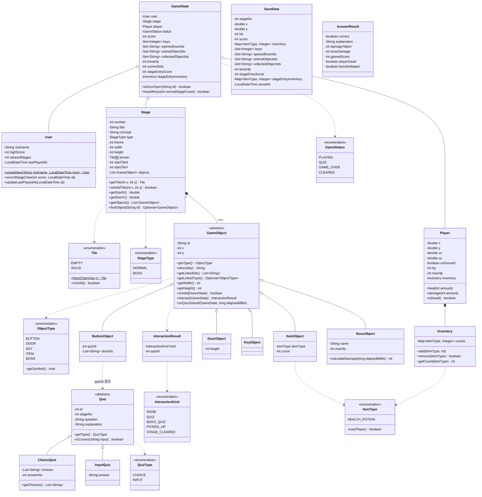
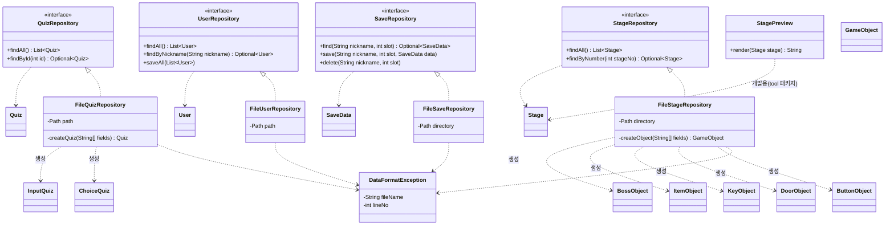
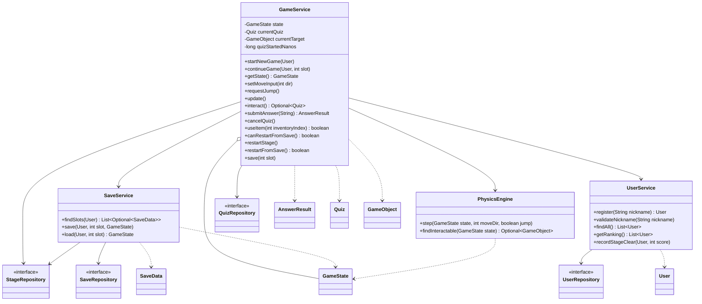
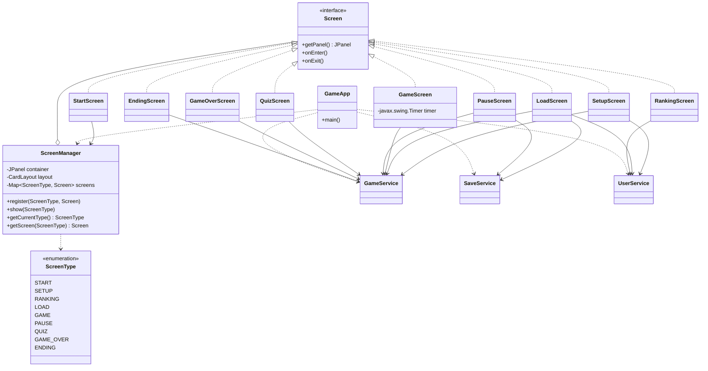

# 클래스 다이어그램

`project.md`, `architecture.md`, `data-format.md` 기준. 문제와 스테이지는 파일을 직접 편집해 관리하므로 `QuizRepository`, `StageRepository`는 읽기 전용이다.
계층별로 4장으로 나눴다. 다른 계층의 클래스는 이름만 표시했고 필드는 소유한 다이어그램에 있다.

기본 패키지는 `io.github.OOP_project`이다. 패키지는 각 장의 제목에 적었다.

표기: `[문서]`는 문서에 명시된 것, `[도출]`은 데이터 형식·게임 규칙에서 끌어낸 것, `[가정]`은 문서에 없어 임의로 정한 것이다. 확정 시 팀과 협의한다.

계층 간 의존 방향: Screen → Service → Repository 인터페이스 ← File 구현체. 모든 계층이 Model을 사용한다.

## 1. Model (`model`, `model.object`, `model.quiz`)

데이터 클래스. 파일 형식과 대응한다.

## 2. Repository (`repository`, `repository.file`)

데이터 접근 계층. Model 클래스는 이름만 표시했다. 필드는 1번 다이어그램 참조.

## 3. Service (`service`)

게임 규칙 계층. Repository와 Model은 이름만 표시했다.

## 4. Screen과 GameApp (`ui`, `ui.screens`, `common`, 루트)

UI 계층과 객체 조립. Service는 이름만 표시했다.

## 필드 근거

| 클래스                            | 근거                                                                                                                                              |
| --------------------------------- | ------------------------------------------------------------------------------------------------------------------------------------------------- |
| `User`                            | `users.txt` 4개 필드: 닉네임, 최고점수, 클리어 수, 마지막 플레이 일시 `[문서]`                                                                    |
| `SaveData`                        | `slotN.txt` 14개 필드 순서 그대로 `[문서]`                                                                                                        |
| `Quiz`, `ChoiceQuiz`, `InputQuiz` | `quiz.txt` 7개 필드. 보기는 `~` 구분 리스트, 객관식 정답은 1부터의 번호, 입력형 정답은 문자열 `[문서]`                                            |
| `Stage`, `Tile`, `StageType`      | `stageN.txt` 정보 줄(번호·제목·학습 개념·유형·테마·가로·세로)과 지형 문자 `#` `.` `P` `[문서]`. 시작 타일 `startTileX/startTileY`는 `P`에서, `getStartX/getStartY`는 그 타일에 서는 좌표 `[도출]`      |
| `GameObject` 하위 클래스          | 오브젝트 줄의 종류별 세부값 `[문서]`. `getWidth/getHeight`와 `isSolid` 시그니처는 `[도출]`                                                        |
| `InteractionResult`               | `architecture.md`의 설명에서 `[도출]`. 종류 5개는 `BUTTON` 퀴즈, `KEY` 클리어, `ITEM` 획득, `BOSS` 퀴즈를 구분하려는 것이다 `[가정]`              |
| `ItemType`, `Inventory`           | `ITEM` 오브젝트의 아이템 종류와 세이브의 `종류:개수` 인벤토리 `[문서]`, 메서드는 `[도출]`                                                         |
| `Player`                          | 위치(타일 단위 실수), 속도, 바닥 여부, 체력, 인벤토리. 위치와 체력은 세이브 필드에서 `[문서]`, 속도와 `onGround`는 중력·점프에서 `[도출]`         |
| `GameState`                       | "화면 간에 넘길 상태는 service가 보관한다" `[문서]`. 열린 문·푼 오브젝트·획득 오브젝트 ID 집합과 스테이지 입장 시점 값은 세이브 필드에서 `[도출]` |
| `GameStatus`                      | 퀴즈 중, 게임 오버, 클리어 흐름에서 `[도출]`                                                                                                      |
| `AnswerResult`                    | `submitAnswer`가 판정, 체력·점수·보스 데미지를 반영한다는 설명에서 `[도출]`                                                                       |
| `PhysicsEngine`                   | 중력, 점프, 충돌, 상호작용 대상 탐색 `[도출]`                                                                                                     |
| `SaveService`                     | 슬롯 목록·저장·불러오기를 `GameService`에서 분리 `[가정]`                                                                                         |
| `DataFormatException`             | "형식이 맞지 않으면 줄 번호를 포함한 예외를 던진다" `[문서]`                                                                                      |

## 확정이 필요한 가정

- **수치**: 중력, 점프 속도, 최대 체력, 오답 데미지, 포션 회복량, 보스 데미지 범위, 점수 값은 `architecture.md`의 초기안이다. 플레이해 보며 조정한다.
- **오답 후 동작**: 일반 퀴즈는 틀려도 재도전할 수 있고 취소해도 페널티가 없다. 이 둘이 체력 압박을 없애지 않는지 확인이 필요하다.
- **스테이지 클리어 조건**: 열쇠를 얻으면 바로 클리어되고 다음 스테이지로 넘어간다. 별도 출구 문을 둘지 정해지지 않았다.
- **"처음부터 시작"의 범위**: 현재 스테이지의 시작 지점으로 되돌린다. 게임 전체의 처음으로 돌아가는 것이 아니다.
- **"마지막 저장 위치"의 기준**: 이번 게임에서 마지막으로 저장하거나 불러온 슬롯이다. 그런 슬롯이 없으면 선택할 수 없다.
- **보스 퀴즈 풀**: `quiz.txt`에서 보스 스테이지 번호를 가진 문제 전부를 쓴다. 문제를 다 내면 다시 섞는다.
- **이어하기 시 풀이 시간**: 퀴즈 중에는 저장할 수 없다(정지 화면으로 갈 수 없다). 퀴즈 화면에서 ESC는 취소로 처리한다.
- **화면 간 이동 주체**: 화면이 `ScreenManager`를 직접 호출하는지 콜백을 쓰는지 정해지지 않아, 화살표는 `StartScreen → ScreenManager`만 그렸다. 나머지 화면도 `show()`를 호출하게 되므로 구현 시 주입 방식을 정한다.
